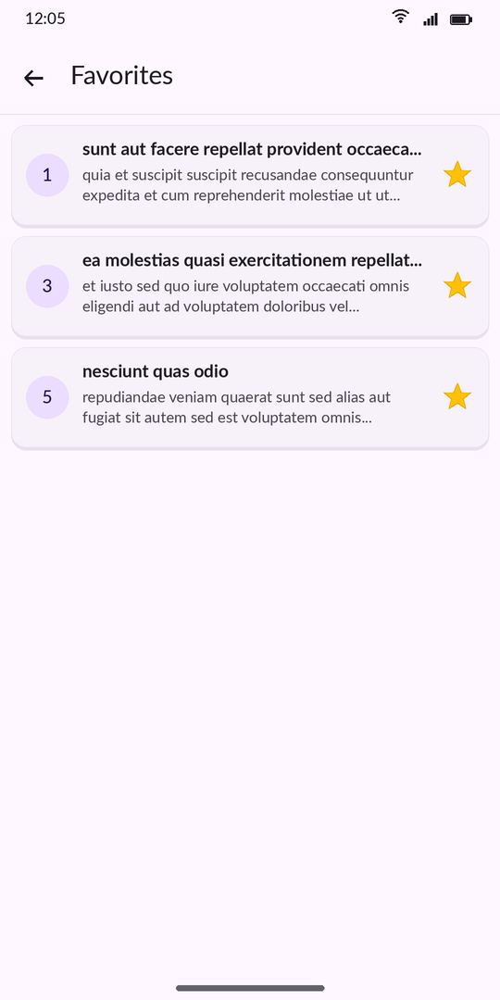
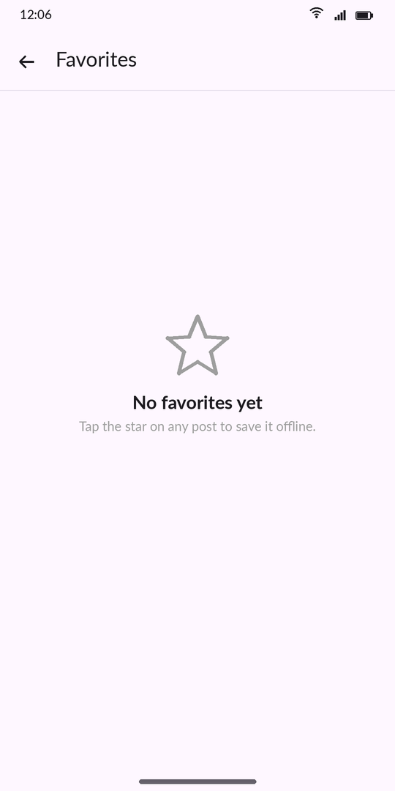
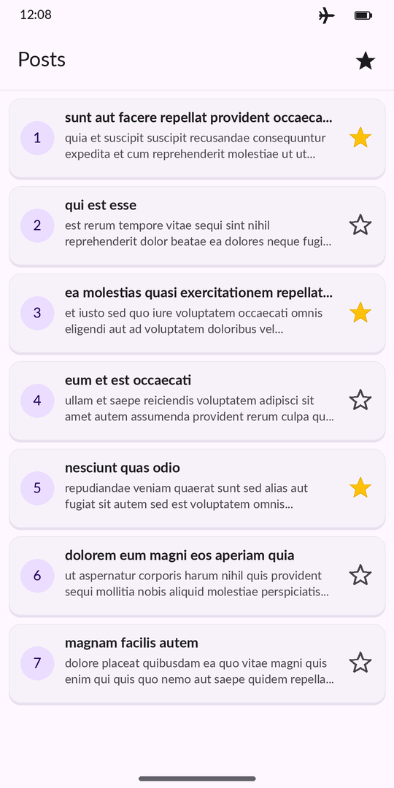
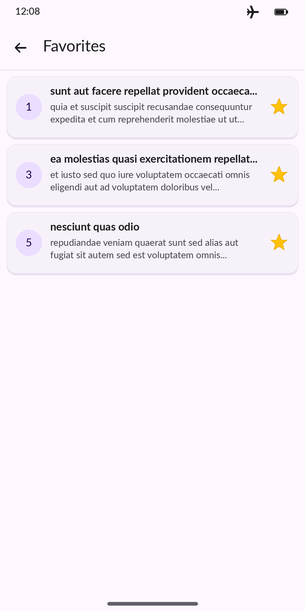
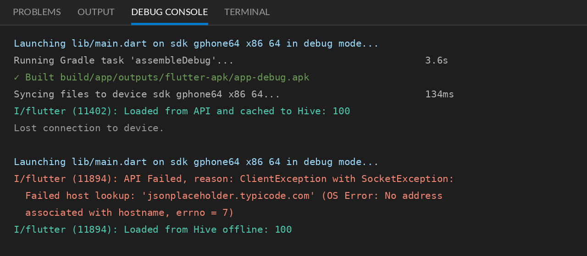

# Offline Posts App with Hive (Favorites Assignment)

**Student:** Mohab Medhat Ali
**Student ID:** 23010016
**Course:** Fall 2026, Section 5, Hive (Local NoSQL Storage)

A Flutter app that fetches posts from the JSONPlaceholder API, caches them in a local **Hive** database, and keeps working with no internet connection. The assignment adds a **Favorites** feature stored in its own Hive box, so favorites survive refreshes, app restarts, and airplane mode.

---

## Features

- Fetches posts from the API and caches them in Hive (`postsBox`).
- Offline mode: if the API call fails, the last saved posts are shown from Hive.
- Friendly error when there is no internet and no cached data.
- Pull-to-refresh to re-fetch and re-cache posts.
- Favorites saved in a separate box (`favoritesBox`).
- Star icon on each post (filled = favorite, outlined = not favorite) that updates immediately.
- Favorites screen opened from a button in the Posts AppBar.
- Empty state message: "No favorites yet".

## API Used

| Method | URL |
|--------|-----|
| GET | `https://jsonplaceholder.typicode.com/posts` |

## Data Flow

```
Before (online-only):   INTERNET -> API -> ListView
After  (offline):       INTERNET -> API -> Hive -> ListView
```

`PostService.getPosts()` decides what to return:

1. Open `postsBox`.
2. Try to fetch from the API.
3. Success: clear the box, save the new posts, return them.
4. Failure: if the box has data, return it. Otherwise throw `No Internet and No Cached Data`.

## Project Structure

```
lib/
├── main.dart                        // init Hive, register adapter, open boxes, run app
├── models/
│   ├── post_model.dart              // Post class + Hive annotations
│   └── post_model.g.dart            // generated TypeAdapter
├── services/
│   ├── post_service.dart            // API + Hive logic (data layer)
│   └── favorites_service.dart       // toggleFavorite / isFavorite / getFavorites
└── screens/
    ├── posts_screen.dart            // posts list + star button + Favorites AppBar action
    └── favorites_screen.dart        // saved favorites list + empty state
```

## Favorites Implementation

- **Separate box:** `getPosts()` calls `postsBox.clear()` on every refresh, so favorites live in `favoritesBox` to avoid being wiped.
- **Key = post id:** `box.put(post.id, copy)`, `box.containsKey(id)` and `box.delete(id)` handle add, check and remove.
- **Save a copy:** a `HiveObject` can only live in one box at a time, so a new `Post` copy is saved instead of the instance from `postsBox`.
- **Live UI:** `ValueListenableBuilder` with `Hive.box<Post>('favoritesBox').listenable()` rebuilds the stars and the Favorites screen whenever the box changes.

### FavoritesService API

| Method | Description |
|--------|-------------|
| `toggleFavorite(Post post)` | Adds the post to favorites, or removes it if already saved |
| `isFavorite(int id)` | Returns `true` if the post id is in `favoritesBox` |
| `getFavorites()` | Returns all saved favorite posts |

## How to Run

```bash
flutter pub get
dart run build_runner build --delete-conflicting-outputs
flutter run
```

Dependencies: `http`, `hive`, `hive_flutter`, `connectivity_plus`. Dev dependencies: `hive_generator`, `build_runner`.

> For release builds on Android, make sure `android.permission.INTERNET` is declared in `android/app/src/main/AndroidManifest.xml`.

---

## Screenshots

### 1. Posts screen: favorites marked with a filled star


### 2. Favorites screen: saved favorites


### 3. Empty state: "No favorites yet"


### 4. Offline test: Posts screen in airplane mode (loaded from Hive)


### 5. Offline test: Favorites screen in airplane mode (favorites still saved)


### 6. Console output: API load and cache, then offline load from Hive
First run prints `Loaded from API and cached to Hive: 100`. After going offline, the API call fails and the app prints `Loaded from Hive offline: 100`.


